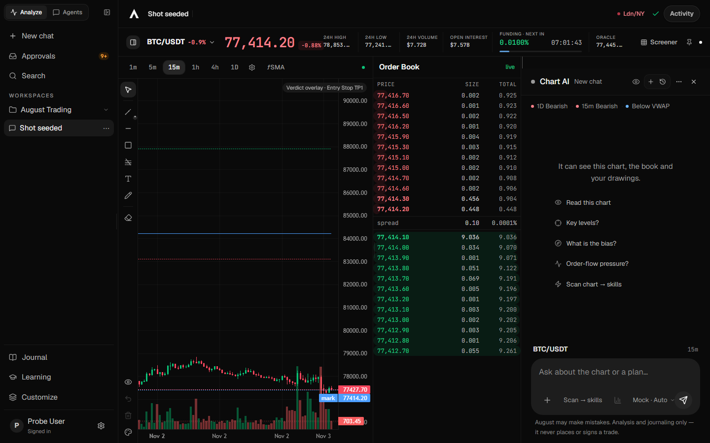
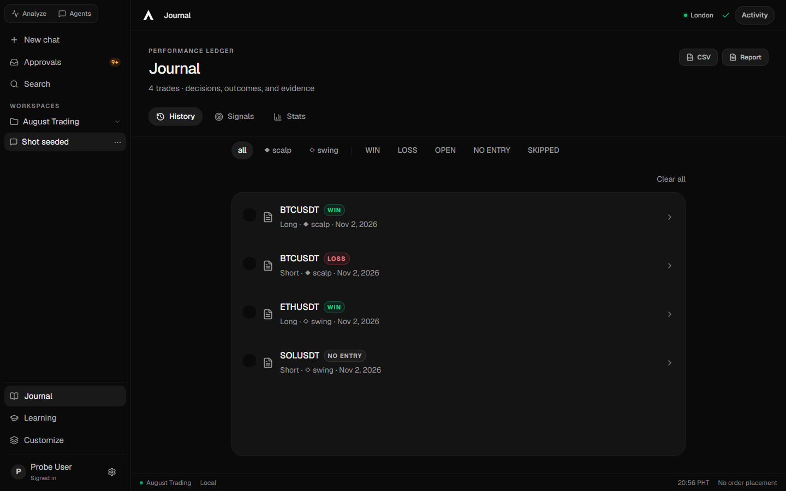
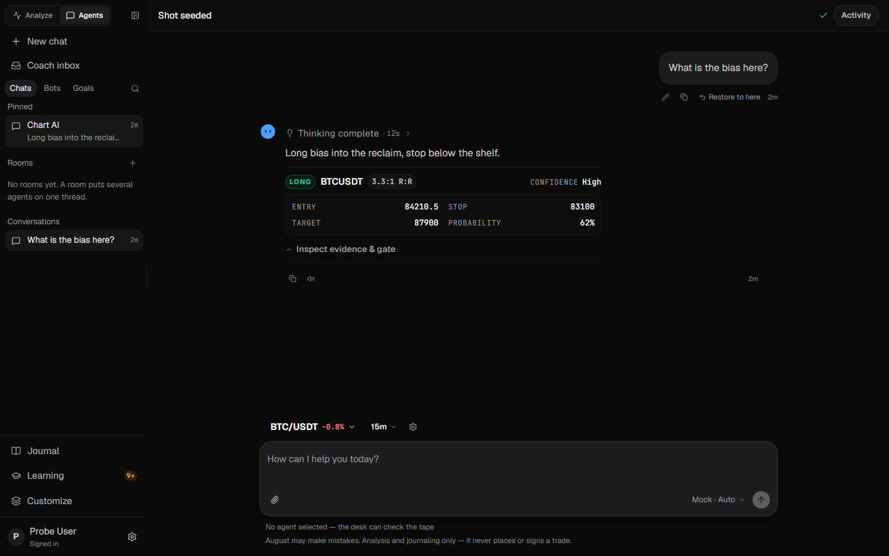
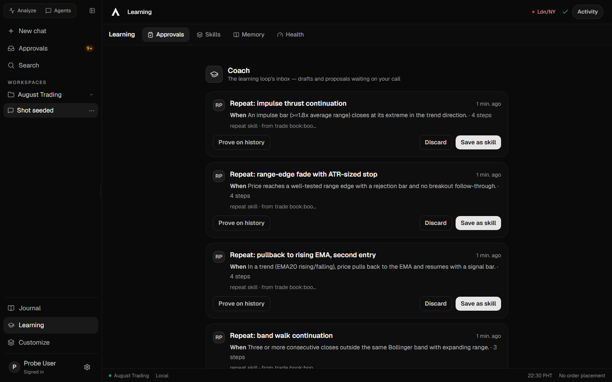

# The four surfaces

August has four top-level surfaces and one overlay (Settings). Their **ids are load-bearing** —
`trade`, `journal`, `agents`, `learn` — because stored routes and dozens of gates pin them. Their
**labels are what the trader reads**, and a label names the function, never a capability the app
lacks.

| Surface | id | Shortcut | It is for | It is not |
|---|---|---|---|---|
| **Analyze** | `trade` | Alt+1 | reading one instrument and running the desk on it | an execution terminal — it never places an order |
| **Journal** | `journal` | Alt+2 | the record of what was decided, plus the review over it | a library of old analyses |
| **Agents** | `agents` | Alt+4 | the named bot roster, DMs, rooms, and the same thread as the chart dock | one generic assistant |
| **Learning** | `learn` | Alt+5 | the notebook, skill documents and learning diagnostics | a skill approval or performance ledger |
| Settings | — | overlay | configuration and data | a surface; it mounts over whatever is current |

Alt+3 is not a surface: it is the rail's **Skills** row, which opens **Learning → Skills**. The
chord and its icon kept their meaning; only the destination changed.

## Analyze (`trade`)

Anatomy, top to bottom:

- **Chart head** — one quiet line: `SymbolPicker`, hero price (`text-ui-price` mono tabular-nums), change, funding + countdown, feed dot. No metrics band and no tool buttons: the **market screener** and **pinned signals** live in the symbol picker's foot, where a trader already goes to change instruments (`src/components/trade/SymbolPicker.tsx` › `SymbolPicker`). The screener's **Best setups** sort ranks by the same confluence score the desk's `find_best_setups` tool prints, so the table and the model name the same best coins (`src/services/trade/bestSetups.ts` › `rankBestSetups`). `src/components/trade/TradeView.tsx` › `TradeView`
- **Crosshair readout** — the 24h high/low/volume/OI/oracle fields the band held appear ONLY while the pointer is over the plot, then leave with it; the grid is fainter than v2's and a verdict draws at most four lines (entry, stop, two targets). `src/components/trade/TradingChart.tsx` › `TradingChart`
- **Drawing tools** — the resting rail is four tools (cursor, trend, horizontal, zone); fib, text, freehand and eraser live behind one caret. `src/components/trade/ChartToolRail.tsx` › `ChartToolRail`
- **Composer** — the box is `+` / model / send. **Full analysis** rides the `+` menu; the automatic chart-to-skills action is removed. `src/components/trade/panels/ChatComposer.tsx` › `ChatComposer`
- **Activity** — the account row's inbox control opens a drawer saying **Nothing running** and explaining that detached skill evaluations were retired; it no longer lists skill audits. `src/components/settings/JobsDrawer.tsx` › `JobsDrawer`. The content bar has no status cluster; a failed profile save still shows "Save failed".
- **Order-book drawer** — 30px strip (name, live state, spread) closed by default, expands on demand. Analyze-only. Narrow (<1024) Book mode = full-height pane. `src/components/trade/TradeView.tsx` › `TradeView`
- **Chart AI dock** — `useRightPanel` default 364px (min 300 / max 820), resize + collapse rail. Dock body order: BiasChips line, SignalCard, KeyLevels Disclosure, DeskScorecard, user bubble (max 80%), AnalyzedRow, AnswerBody (font-reading), MemoryProvenanceStrip, VerdictAudit gate behind "Inspect evidence & gate" Disclosure, prov line (code-calculated only). `src/components/trade/panels/ChatTranscriptList.tsx` › `ChatTranscriptList`
- **Narrow <1024** — three-mode switcher **Chart | AI | Book**, one pane at a time.

Live state: one websocket bundle per symbol drives strip + book + candles; REST polling takes over
the moment the socket drops, and the chart's own stall watchdog re-syncs a quiet stream. Prices are
realtime or visibly healing — never silently stale.

Never: executes an order, touches an exchange account, or holds a trading key.

## Journal (`journal`)

- **History** — the trade ledger: every logged trade, its plan, its outcome.
- **Stats** — win-rate and equity-curve dashboards over the same rows.
- **Review cards** — weekly and monthly reviews.
- **Export** — CSV and the printable trade report (open it and print to PDF).

The trade ledger supports journal-based reviews. Signal price outcomes and tracked diagnoses are
separate evidence; learning is not limited to human-logged trades.

## Agents (`agents`)

Three regions: a sparse rail, a main pane, and one pill composer. The rail's top is the
**Analyze ⇄ Agents mode switch** — a route between the charted and focused forms of the same desk,
not a per-turn mode. Journal, Learning and Customize sit at its foot.

- **Conversation list** — `ConversationGroups`, the SAME component `ShellRail` renders: New chat + Ctrl K, Pinned (only when there are pinned rows), Recent (always). Rows: hollow dot (filled active, amber pulsing running), truncated title, mono age (`workspaceAgeLabel`). No Goals/Agents/Rooms groups — chat-only. `src/components/shell/ConversationGroups.tsx` › `ConversationGroups`
- **Chat full view = AgentsView** — id stays `agents`, label is **Chat**. Greeting sparse. `ChatTranscriptRow` renders bubble/failure/AI with `BotFace` + `ChatWorkTimeline` + `AnswerBody` + `SignalCard` + KeyLevels + chatChips incl. `FeedbackChips`. Follow-up line renders ONLY if backed by a real computed suggestion; otherwise omitted. `src/components/shared/ChatTranscriptRow.tsx` › `ChatTranscriptRow`
- **SignalCard** — shared by dock + Chat. Headline Direction + COIN, meta (R:R, interval, conviction), 4-row kv (Entry=info cyan, Stop=trade-down, Target=trade-up, Prob. w/ bar+base tick ONLY if `SignalRecord` carries `probability`/`baseRate`/`sampleN` — else omitted), Trigger/Invalidation, evidence, actions (Show on chart/Log plan/Copy), mono sigmeta (signalId·age·expiresAt countdown·venue). `signalIdFromActions` reads `ToolAction.signalId` for `emit_signal`. Ledger via `readSignals`/`summariseSignals` only — never fabricate probability/confidence. `src/components/trade/SignalCard.tsx` › `SignalCard`
- **DeskScorecard** — Disclosure "Scorecard · X% vs Y% base (n=N[, thin])". `src/components/trade/SignalCard.tsx` › `DeskScorecard`
- **BiasChips** — 6px dots, one line, honest failure (nothing until data). Mounted in AgentsView too. `src/components/trade/BiasChips.tsx` › `BiasChips`
- **Composer** — box-only (no context/quick-action chips). Keeps `ChatAttachmentStrip`, `ModelFallbackBanner`, disclaimer verbatim "Analysis and journaling only — it never places or signs a trade." Textarea autosize 1-line. `src/components/trade/panels/ChatComposer.tsx` › `ChatComposer`

- A send routes on **what is selected**, not on a send-mode switch (there is none inside the
  composer): a selected bot answers through the bot turn path; nothing selected hands the text to
  the real pipeline, so desk tools and memory run exactly as they do from the chart dock.
- Rooms delegate to the group-round view rather than reimplementing it.
- **One thread across homes.** The Agents surface and the chart dock show the same conversation
  under the same id; a run keeps its activity line when the trader switches surfaces. Two stores,
  one thread — this is a contract, not an implementation detail.
- An agent's card opens in `DetailModal`.
- The product's one AI response is claimed by **identity** (`Message.botId`), never by
  provider+model.

## Learning (`learn`)

**Learning** lands on the notebook and **Skills** lands on the library. Both rows are in the rail,
so the landing tab is part of the route (`App.tsx` › `App` `selectSurface`, `openSkills`): while
Learning inherited the library default the two rows drew one screen, which the owner named twice.

**Owner refactor, 2026-11-06.** Tabs remain Skills, Memory and Health:

1. **Skills** — document folders (`SKILL.md` plus optional support files). The trader can search,
   read (the body renders as markdown), edit (a Write/Preview toggle over the same renderer, plus a
   live hint for the suggested body headings), delete or import through
   `src/components/skills/SkillLibrary.tsx` › `SkillLibrary`;
   the model uses `skill_index`, `skill_view` and `skill_write`. There are no candidate/confirmed/
   retired states, tentative switch, approvals, outcome scores or automatic skill writers.
   All skills are context, never deterministic predicates, vetoes or confidence caps.
2. **Memory** — the notebook browser, including per-topic detail docks.
3. **Health** — learning/profile summaries, harness lessons, versions, usage and diagnostics,
   not a skill evaluation or format-certification screen.

The write/import checks and migration limits are in [the learning loop](../../architecture/learning-loop.md).
Never: the playbook library. Playbook Studio owns that table under Settings → Playbooks.
Never: an Approvals tab — skills have no approval queue. The separate memory corrections log
(with Undo) lives in Settings → Memory.

## Settings (overlay)

Grouped, in this order:

- **Setup** — AI setup (providers, keys, models).
- **Analysis** — Analysis, Prompts, Instructions.
- **Learning** — Memory, Playbooks.
- **Account** — Profile, Journal, Data.

Data is where back up / export / import lives. It is the only surface that can destroy or restore
the trader's journal in bulk; treat it accordingly.

## The shell

- **One full-height rail, two shapes** (mock v3): a 48px icon strip — Analyze, Agents, then
  Journal and Learning. There is no account avatar anywhere in the shell: no avatar button in the
  strip, and the account row at the column's foot carries `name · Signed in · local-first` with no
  initials block. Settings stays on Ctrl/Cmd+ and the account row's own control. On **Analyze**
  the strip is the whole sidebar: the conversation column is NOT mounted, so the chart never pays
  240px for an empty list, and the title-row toggle puts the rail away. On the surfaces that mount
  the column (Journal, Learning; the Chat surface mounts its own open column), it holds **New chat**
  (Ctrl/Cmd+K still works, but no keycap badge is printed), **Pinned** (only when rows are
  pinned), **Recent** (a hide icon sits after the heading; a row shows the side of the thread's
  latest signal — `Long`/`Short` — read from the ledger), and the account row at its foot. No
  Search row and no mode switch in the column: the rail owns the surfaces, the column owns the
  record, and the desk's search lives in the Agents column's own field.
- On the **Agents** surface the thread is CENTRED and the conversation column mounts OPEN with the
  rail (conversations above the roster). The hide icon after RECENT puts the whole sidebar away,
  and the title-row toggle brings it back; there is no clock/column icon in the icon rail. Its
  Chats | Bots tab strip is DELETED: one scroll of sections.
- The **content bar** is the hide-conversation toggle, the title, the instrument context and one
  muted **Live** pill (its popover still carries sessions, market conditions, Live market and
  Vision data). No brand mark, no save tick, no Activity pill. `AgentsView`'s own bar IS that bar
  — no second header stacks above it.
- The conversation column is 240px by default and drags from its right edge (200–360px; the width
  persists and double-click restores 240); Analyze mounts no column, so its rail is 48px and has
  nothing to resize. The content bar's toggle puts the rail away; collapsed it leaves the
  layout, and that same toggle is the ONLY way back — navigation never rides the content bar.
  Below 1024px it is a drawer over the content instead of a column — opening it never
  squeezes the chart to a sliver — and the drawer's own mode switch and utility rows carry every
  route. The old four-tab bar is deleted, not hidden.
- **Hide conversation** — there is ONE action: putting the whole sidebar away. It has two doors
  where the column is mounted, because a collapsed rail is 0px and needs a way back. The title-row
  toggle left of "Chart AI" is labelled **Hide conversation** (Ctrl/Cmd+B) and flips to **Show
  conversation** while the rail is away; it stays on screen precisely because the rail has no
  edge to click. Inside the list, a small icon **after the RECENT heading** hides the conversation
  column. Analyze mounts no column, so it has no in-column door; its title-row toggle hides the
  icon strip. The old Chats "Hide conversations" clock is gone from the icon rail on every surface:
  the column's own hide icon, in the sidebar, is the control.
  `src/components/shell/SidebarToggle.tsx` › `SidebarToggle` ·
  `src/components/shell/ConversationGroups.tsx` › `ConversationGroups`
- Electron's floor is 800px wide. A layout that only breaks below 1024 is a bug.
- Heavy surfaces are `React.lazy` with `SurfaceSkeleton`, never `fallback={null}`.
- Overlays mount **outside** `<main>`. A probe that measures `<main>` after opening one re-reports
  the previous surface and passes vacuously.

## Current state

One 1440px capture per surface, taken 2026-11-02 from the app with the probe's seeded profile:

| Analyze | Journal |
|---|---|
|  |  |

| Agents | Learning |
|---|---|
|  |  |

[Settings](current/settings.png) is the overlay.

These are orientation, not a gate — `render-probe` is the gate. Re-capture with
`npm run probe:surfaces`, then copy `surface-{analyze,journal,agents,learning,settings}.png` here when
a surface changes materially. The Analyze capture carries a "Memory reviewed" toast because the probe
seeds a notebook first; that is real state, not decoration.

## Changing a surface

1. Read this file and the [charter](charter.md).
2. Reuse the shared components the charter lists; do not hand-roll a pill, a tooltip, a dropdown, a
   modal or a focus ring.
3. Run `npm run render-probe` — it is the only gate that can see a surface mount, a rendered row,
   or an inert control.
4. Look at it in a browser at 1440 and at 800. No gate sees a clipped column.
